# OrbisDesk

[English](README.md) | [Español](README-es.md)

Documentación: [política de idiomas](docs/DOCUMENTATION_POLICY-es.md).

Preparación de Git: [dependencias y reconstrucción](docs/REPOSITORY_LAYOUT-es.md).

Empezar con IA: [guía de trabajo](AGENTS-es.md) e [índice completo](docs/INDEX-es.md).

Escritorio y aplicaciones Windows para PS4, basado en Wine, WoW64 y gráficos nativos. Desde W283, la interfaz, los paquetes y el código propio usan OrbisDesk. Ver [cambio de nombre y compatibilidad](docs/REBRANDING_ORBISDESK-es.md).


Base experimental para portar prospero-win a PS4 y medir sus requisitos en shadPS4. **Ya ejecuta un EXE PE32 que llama a una DLL propia por su IAT en el fork local de shadPS4**, con retorno 42 y relocaciones verificadas. El ELF incorpora el traductor x86 real de prospero-win y adaptadores de memoria, TLS y proceso para PS4. Se compilan DLL PE32 reales de Wine. En el fork Linux, Wine arranca dentro del proceso y ejecuta console32-bare.exe con el traductor como proveedor WoW64 (incremento 23); el oficial sigue bloqueado en esa campaña histórica. Ya hay validación posterior en PS4 real, detallada a continuación.

## Características

- **Escritorio Windows personalizable:** menú Inicio, ventanas, accesos directos y barra de tareas, con temas Aero, Luna y Noir.
- **Aplicaciones de 32 y 64 bits:** ejecución mediante Wine y WoW64, con compatibilidad según el programa.
- **Varias aplicaciones abiertas:** programas que conviven dentro de la misma sesión del escritorio.
- **Gráficos acelerados:** Vulkan y OpenGL, con Direct3D mediante DXVK o WineD3D.
- **Configuración por juego:** selección del renderer y opciones gráficas desde el overlay.
- **Controles:** mando de PS4, teclado y ratón USB.
- **Explorador de archivos:** navegación, creación, renombrado y borrado de archivos y carpetas, y apertura de archivos y ejecutables.
- **Multimedia y navegación web:** VLC para reproducción multimedia y SeaMonkey como navegador.
- **Audio:** salida de sonido para aplicaciones y juegos compatibles.
- **Juegos DOS:** soporte mediante DOSBox Pure.
- **Cliente no oficial de Steam integrado:** inicio de sesión, biblioteca y descarga de juegos.
- **Estadísticas en pantalla:** FPS y uso de CPU y GPU mediante MangoHud.
- **Instalación desde un único PKG:** runtime incluido y preparación automática en el primer arranque.
- **Modos Normal y Root:** selección al iniciar; en modo Root permite montar DVD y unidades externas.

## Juegos probados

Juegos reportados funcionando en PS4 física. Los resultados dependen del juego y
la build; esta lista no implica compatibilidad completa ni haber terminado cada juego.

- Age of Empires 2
- Call of Duty
- GTA 3
- GTA San Andreas
- GTA Vice City
- Juegos DOS vía DOSBox Pure — Mario & Luigi y Carmen Sandiego.
- Max Payne 1 y 2
- Need for Speed Underground 2
- Portal — descargado mediante el cliente no oficial de Steam incluido.
- Quake 3
- Solitaire, Spider y Minesweeper — incluidos en el PKG.
- SuperMarioKart
- The Lost Forest
- Worms 4

## Capturas

| Instalación en el primer arranque | Escritorio y menú Inicio |
| --- | --- |
| 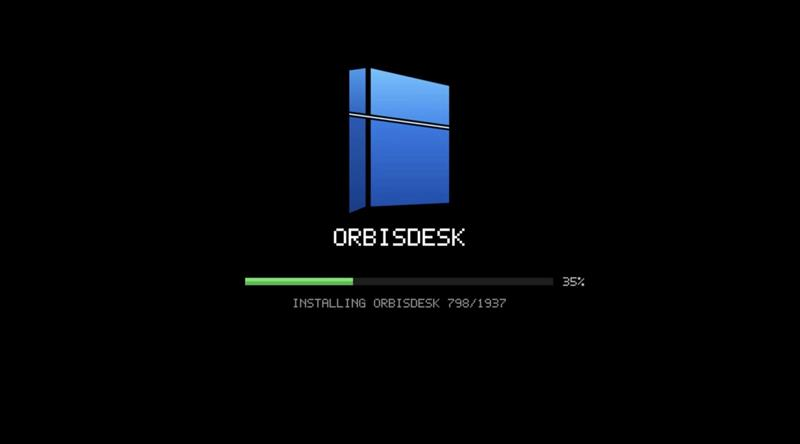 | 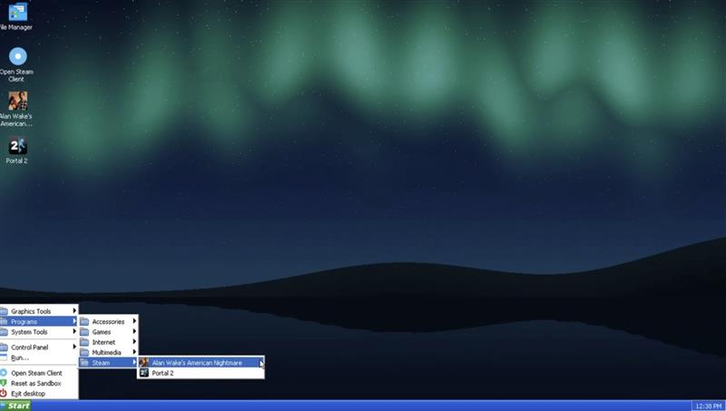 |

| Cliente no oficial de Steam: biblioteca | Detalles del juego instalado |
| --- | --- |
| 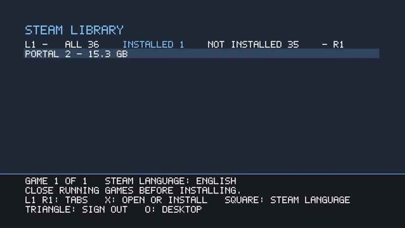 | 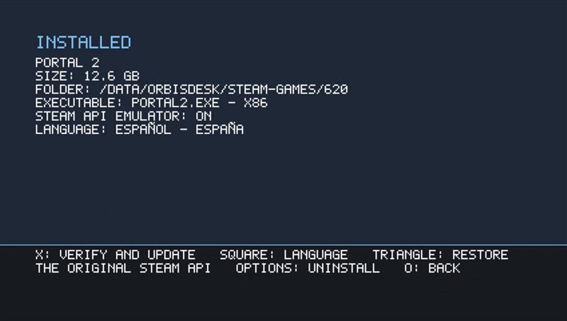 |

| Portal 2: menú principal | Portal 2: overlay durante el juego |
| --- | --- |
| 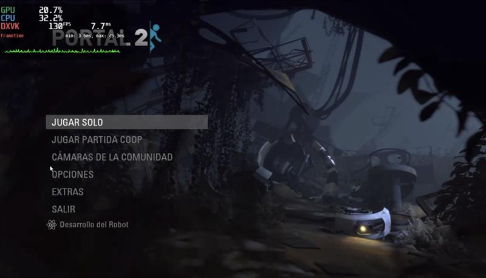 | 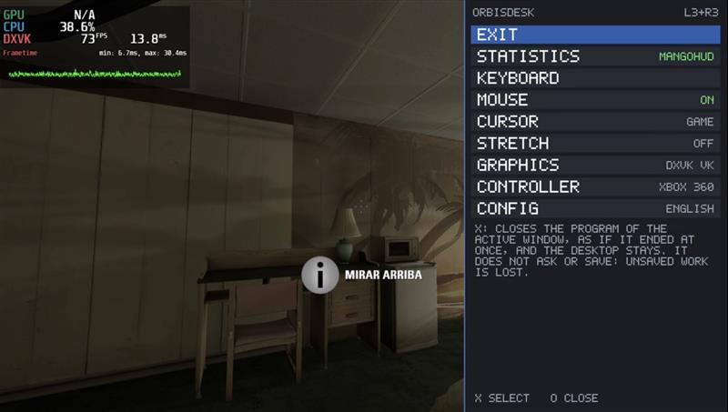 |

| GTA San Andreas: menú principal | GTA San Andreas: partida |
| --- | --- |
| 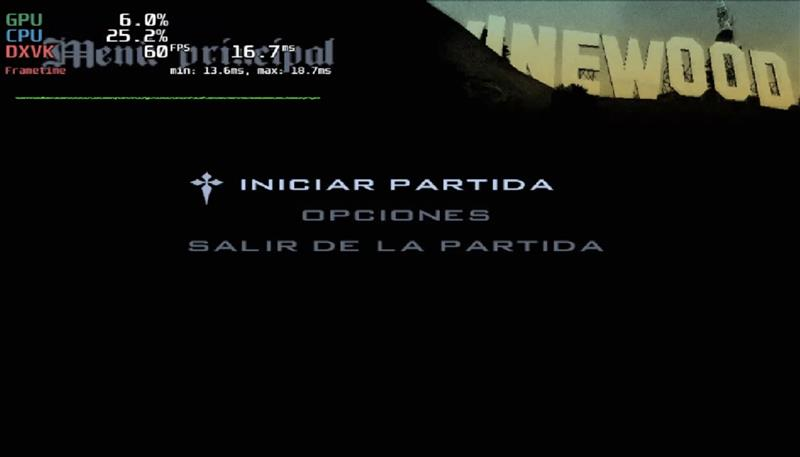 | 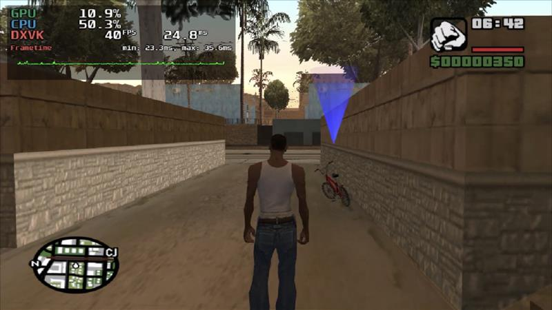 |

| Need for Speed Underground 2: introducción | Need for Speed Underground 2: menú de carrera rápida |
| --- | --- |
| 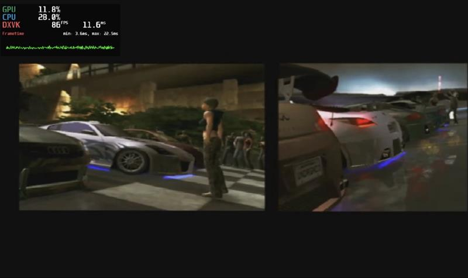 | 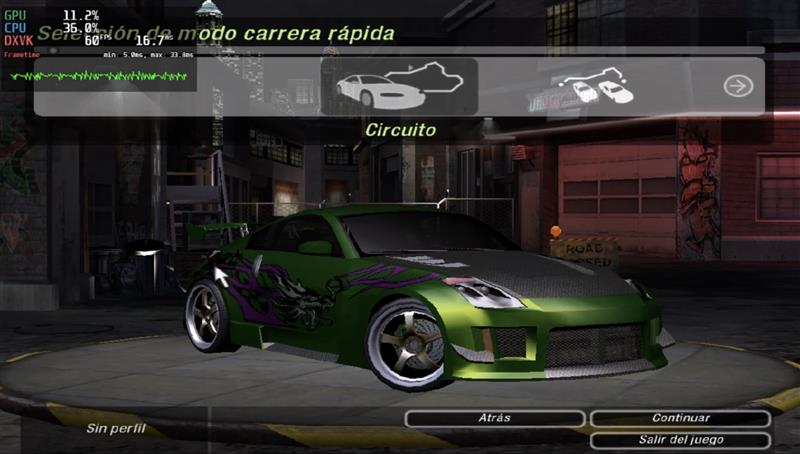 |

| Juegos incluidos | Demos OpenGL y Vulkan |
| --- | --- |
| 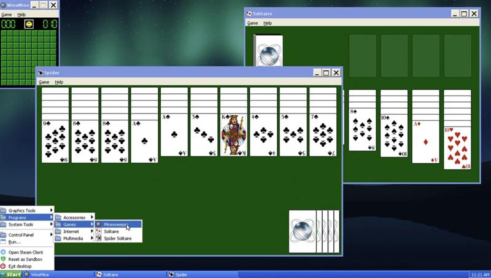 | 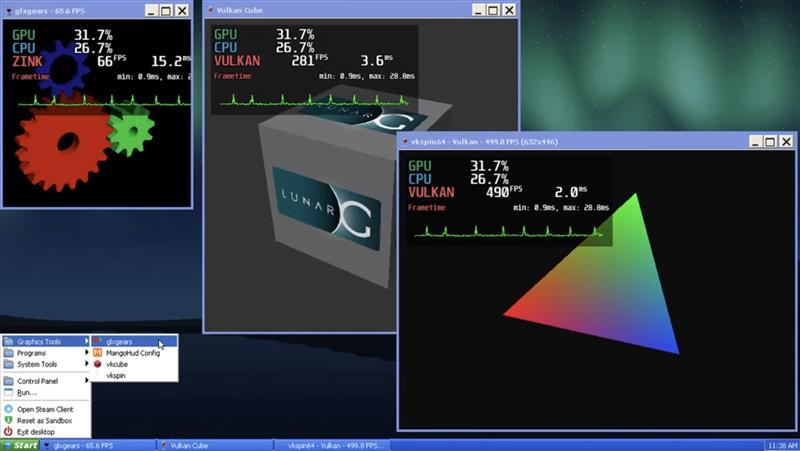 |

| Reproductor VLC | Navegador SeaMonkey |
| --- | --- |
| 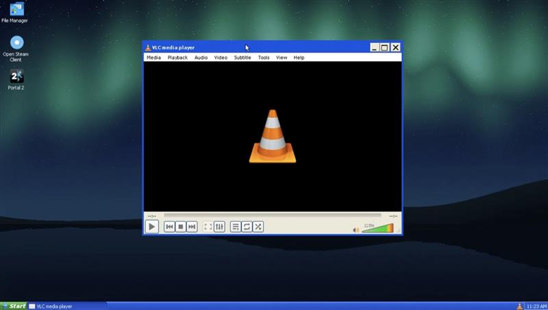 | 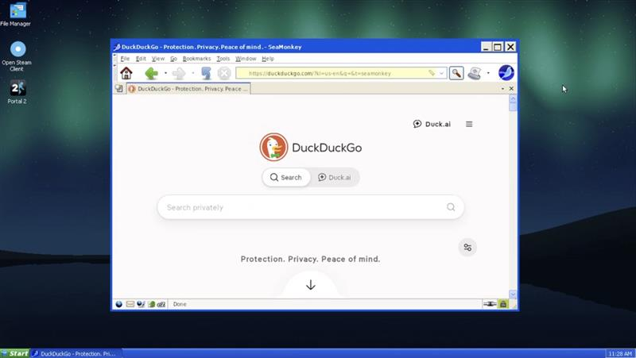 |

## Preparar y compilar

En PowerShell, desde la raíz:

```powershell
./tools/bootstrap.ps1 -InstallBuildTools
wsl -d Ubuntu-22.04
```

En WSL, entrar a este directorio y ejecutar:

```bash
python3 tools/fetch_sources.py
python3 tools/build.py
```

`fetch_sources.py` utiliza exclusivamente `sources.lock.json`; rehúsa sobrescribir checkouts de otra revisión. La fuente de Wine se fija al mismo commit que upstream. Descargarla no implica que se haya construido su port PS4.

`build.py` verifica las fuentes, compila para `x86_64-pc-freebsd12-elf` y Jaguar, genera el OELF y `eboot.bin`, y construye los EXE i386 `console32.exe` y `gdi32.exe`. También comprueba sus arquitecturas y rechaza segmentos PT_LOAD duplicados. El manifiesto `out/build.json` registra herramientas, fuentes y hashes.

Para este hito de C se usa OpenOrbis oficial v0.5.4 y Clang 14 de Ubuntu 22.04. El sysroot C++/Clang 21 de DolphinPS4 y Mesa se reservan para el hito gráfico; todavía no se han construido ni validado. `--sdk`, `--cc` y `--ld` permiten indicar otro SDK/compilador al builder, que queda registrado en el manifiesto.

## Ejecutar los diagnósticos

Las pruebas de desarrollo y regresión en Linux/WSL usan un **fork de shadPS4 con
parches**. Los resultados del emulador oficial se registran por separado; que una
prueba pase en el fork no demuestra compatibilidad con la versión oficial ni con
una PS4 física.

Las fuentes del emulador se reconstruyen desde la revisión upstream y los 17
parches ordenados fijados en [fork.lock.json](fork.lock.json). Los parches están en
[patches/shadPS4/](patches/shadPS4/), seguidos por el
[overlay 0018](patches/shadPS4/pending/0018-fixed-executable-and-kernel-signals.patch)
registrado en [dependencies.lock.json](dependencies.lock.json). El checkout
generado queda en `.deps/shadPS4-fork/`, excluido de Git.

Con el SDK OpenOrbis del paso de preparación disponible, restaurar y compilar el
fork en Ubuntu 22.04/WSL:

```bash
bash tools/ci/install-runner.sh
python3 tools/restore-dependencies.py --fetch --only shadps4-fork
python3 tools/build-shad-linux.py --jobs 4
```

`install-runner.sh` instala los prerrequisitos de compilación Linux fijados,
incluidos Clang 19, libc++ y CMake. El emulador resultante queda en
`build/shadPS4-linux/shadps4`; su identidad de fuentes, diff y hash del binario se
registran en `build/shadPS4-linux/build-manifest.json`. Usar
`python3 tools/run-linux-shad.py --fork ...` para seleccionar ese binario
explícitamente. Ver la [guía de compilación y ejecución del emulador](AGENTS-es.md#6-compilar-y-ejecutar-shadps4)
y los [detalles de reconstrucción de parches](docs/REPOSITORY_LAYOUT-es.md) para los comandos completos.

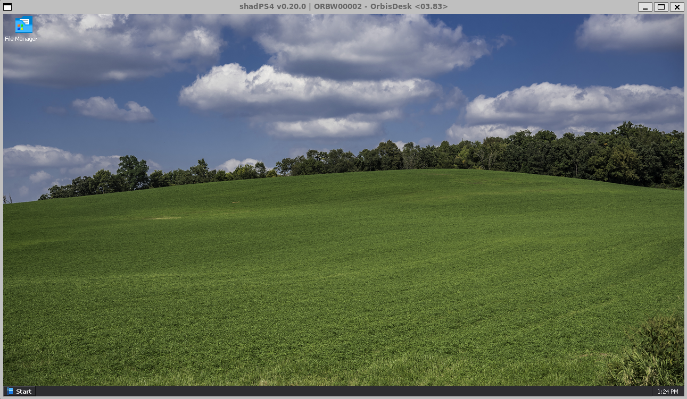

*Escritorio de OrbisDesk W284 / 03.83 en el fork parcheado de shadPS4.*

También está disponible el runner histórico de referencia Windows, en PowerShell:

```powershell
./tools/run-probes.ps1
./tools/run-probes.ps1 -Cases translator-rwx,vm-backend,threads-adapter
./tests/report-classification.ps1
```

Cada caso arranca un proceso nuevo con perfil y `/data` aislados. Los informes quedan en `reports/runs/<fecha UTC>/report.json`, junto con stdout, stderr y los logs del emulador. Una matriz con pruebas bloqueadas devuelve código 1.

Para un emulador modificado en ese runner Windows, usar `-Emulator <ruta> -EmulatorKind fork -EmulatorCommit <SHA completo>`. El binario oficial se identifica por hash; un fork nunca se etiqueta como oficial. Los scripts Windows anteriores, `tools/prepare-shad-fork.ps1` y `tools/build-shad.ps1`, son entradas históricas; la reconstrucción y compilación Linux actuales se muestran arriba.

El runner requiere un inicio y un resultado del invitado, detecta llamadas a stubs y trata timeouts/crashes como bloqueos. Una respuesta simulada de shadPS4 no convierte una prueba en aprobada. Las advertencias sobre imports sin uso se conservan en los logs y se distinguen de stubs efectivamente invocados.

## Organización

- `platform/ps4/`: adaptadores nuevos que consumen la interfaz original de prospero-win.
- `native/`: diagnóstico OpenOrbis, con un caso por ejecución.
- `fixtures/win32/`: programas propios PE32 para los futuros hitos Wine/GDI.
- `tools/`: fuentes fijadas, descargas verificadas, build y captura de evidencia.
- `upstream/`, `.deps/`, `build/`, `out/`: fuentes y artefactos locales regenerables.

Los EXE propios son objetivos de aceptación futuros, no demos declaradas como funcionales en el runtime. El programa de consola prueba cálculo, hilos, carga de DLL y escritura de archivo; el de GDI cambia de color al recibir entrada.

## Licencia

El paquete de OrbisDesk (`OrbisDesk.pkg` y su ELF) se distribuye bajo la **GNU General Public License v3.0 o posterior**. Incluye el cliente nativo de Steam, que reutiliza código de [Playden for PS5](https://github.com/leolobato/playden-ps5) (GPL-3.0-or-later). Por eso la obra combinada es GPL-3.0-or-later.

Cada archivo fuente mantiene la licencia indicada en su cabecera:
- adaptadores, herramientas y fixtures propios: LGPL-2.1-or-later;
- diagnósticos de `native/`: GPL-2.0-or-later;
- Wine: LGPL-2.1-or-later.

Todas son compatibles con GPL-3.0-or-later. La emulación opcional de la API de Steam por juego usa las DLL de [gbe_fork](https://github.com/Detanup01/gbe_fork) sin modificar (LGPL-3.0).

Los textos de las licencias están en [LICENSES/](LICENSES). Los componentes, versiones y procedencia se detallan en [THIRD_PARTY.md](THIRD_PARTY-es.md).

El cliente de Steam no es oficial y Valve no lo respalda. Steam es marca de Valve Corporation.
