# OrbisDesk

[English](README.md) | [Español](README-es.md)

Documentation: [language policy](docs/DOCUMENTATION_POLICY.md).

Git preparation: [dependencies and reconstruction](docs/REPOSITORY_LAYOUT.md).

Start with AI: [development guide](AGENTS.md) and [complete documentation index](docs/INDEX.md).

Windows desktop and applications for PS4, based on Wine, WoW64 and native graphics.
Since W283, the interface, packages and project code use the OrbisDesk name.
See [renaming and compatibility](docs/REBRANDING_ORBISDESK.md).

Experimental base for porting prospero-win to PS4 and measuring its requirements in shadPS4.
**It already runs a PE32 EXE that calls a project DLL through its IAT in the local
shadPS4 fork**, returning 42 with verified relocations. The ELF incorporates the
actual prospero-win x86 translator and PS4 memory, TLS and process adapters.
Actual Wine PE32 DLLs are built. In the Linux fork, Wine starts inside the process
and runs console32-bare.exe with the translator as its WoW64 provider (increment 23);
the official emulator remains blocked in that historical campaign. Later validation
on physical PS4 hardware is detailed below.

## Features

- **Customizable Windows desktop:** Start menu, windows, shortcuts and taskbar, with Aero, Luna and Noir themes.
- **32-bit and 64-bit applications:** execution through Wine and WoW64, with compatibility depending on the program.
- **Multiple applications at once:** programs running together within the same desktop session.
- **Accelerated graphics:** Vulkan and OpenGL, with Direct3D through DXVK or WineD3D.
- **Per-game configuration:** renderer selection and graphics options from the overlay.
- **Controls:** PS4 controller, USB keyboard and mouse.
- **File manager:** browse, create, rename and delete files and folders, and open files and executables.
- **Multimedia and web browsing:** VLC for media playback and SeaMonkey as a browser.
- **Audio:** sound output for compatible applications and games.
- **DOS games:** support through DOSBox Pure.
- **Integrated unofficial Steam client:** sign in, browse your library and download games.
- **On-screen statistics:** FPS, CPU and GPU usage through MangoHud.
- **Single-PKG installation:** included runtime and automatic setup on first launch.
- **Normal and Root modes:** choose at startup; Root mode allows mounting DVDs and external drives.

## Tested games

Games reported running on physical PS4. Results depend on the game and build;
this list does not imply complete compatibility or a completed playthrough.

- Age of Empires 2
- Call of Duty
- DOS games via DOSBox Pure — Mario & Luigi and Carmen Sandiego.
- GTA 3
- GTA San Andreas
- GTA Vice City
- Max Payne 1 and 2
- Need for Speed Underground 2
- Portal — downloaded using the included unofficial Steam client.
- Quake 3
- Solitaire, Spider and Minesweeper — included in the PKG.
- SuperMarioKart
- The Lost Forest
- Worms 4

## Screenshots

| First-start installation | Desktop and Start menu |
| --- | --- |
| 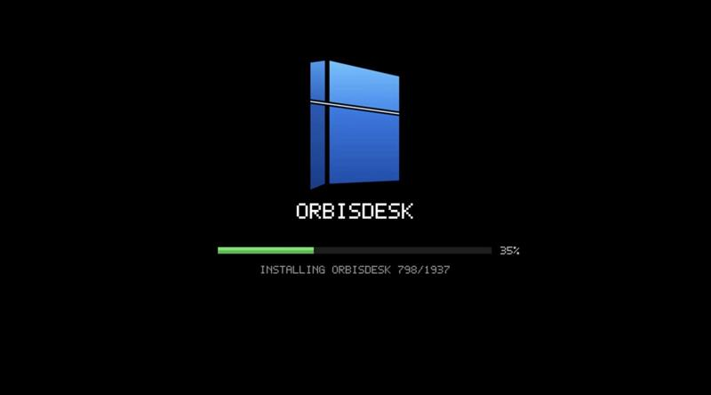 | 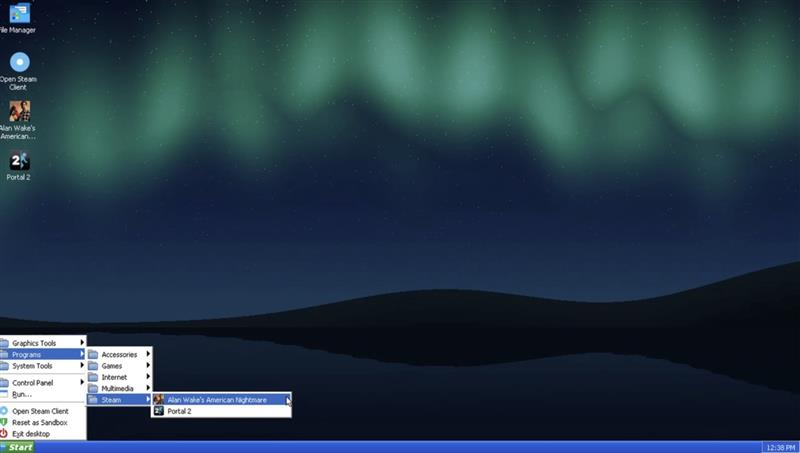 |

| Unofficial Steam client: library | Installed game details |
| --- | --- |
| 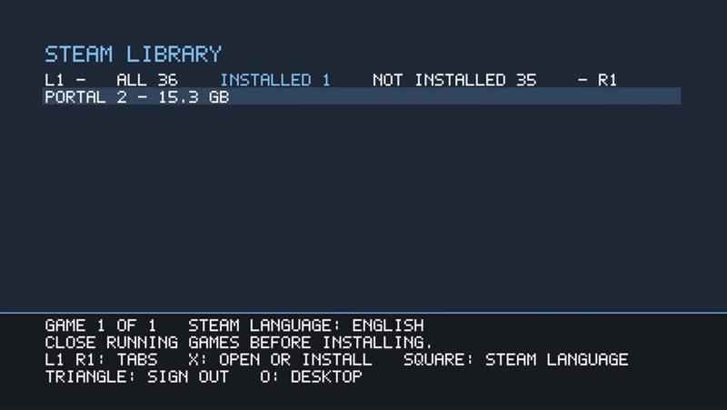 | 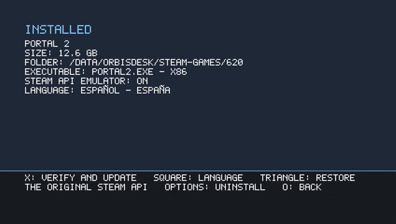 |

| Portal 2: main menu | Portal 2: in-game overlay |
| --- | --- |
| 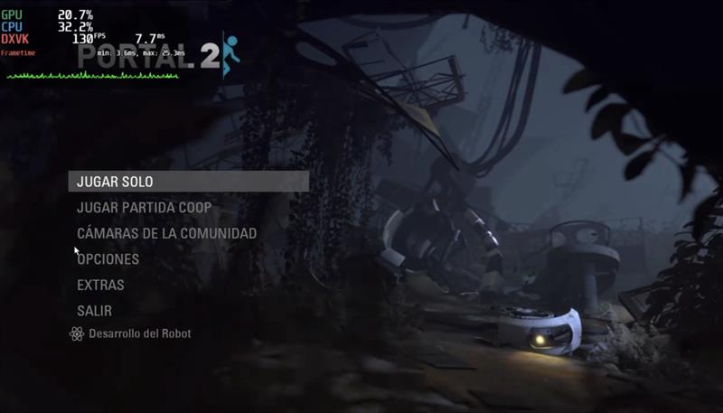 | 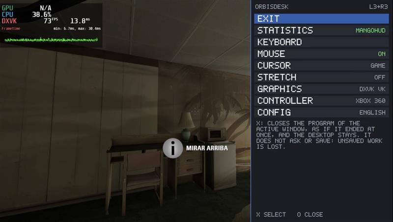 |

| GTA San Andreas: main menu | GTA San Andreas: gameplay |
| --- | --- |
| 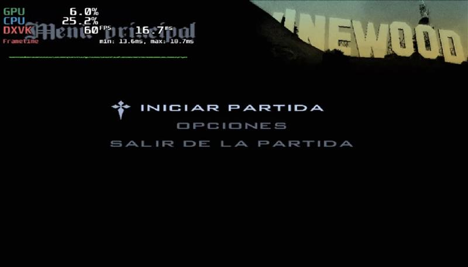 | 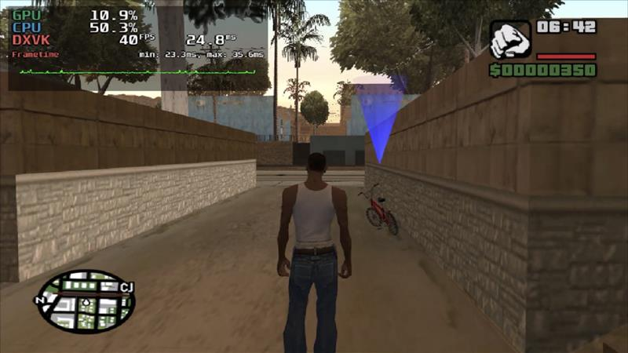 |

| Need for Speed Underground 2: intro | Need for Speed Underground 2: quick race menu |
| --- | --- |
| 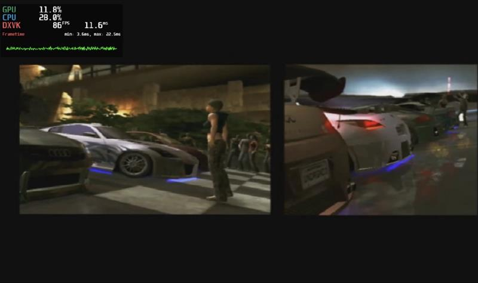 | 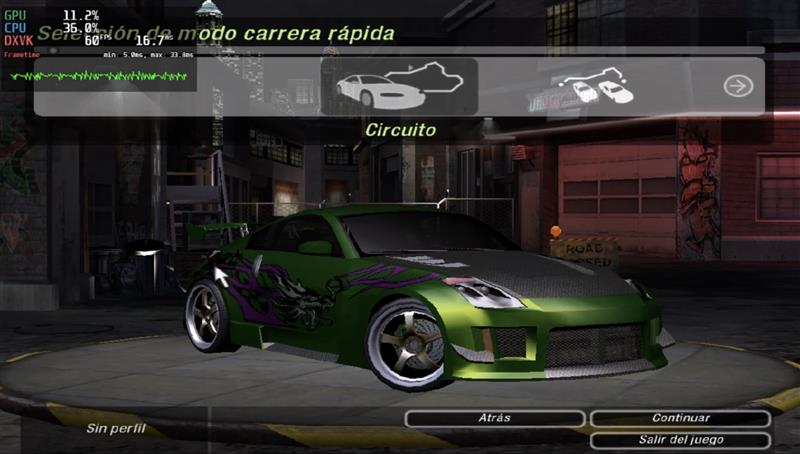 |

| Included games | OpenGL and Vulkan demos |
| --- | --- |
| 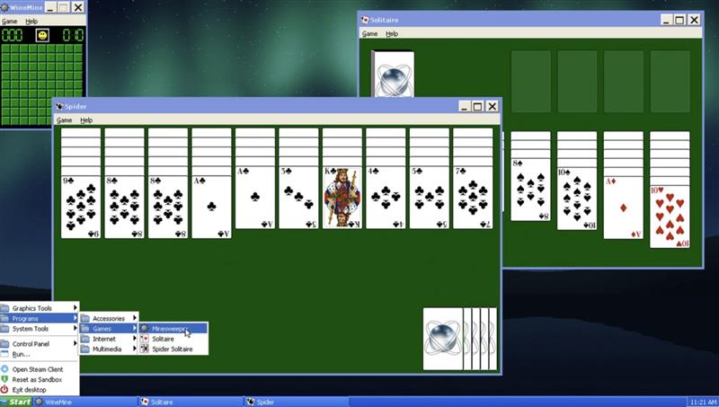 | 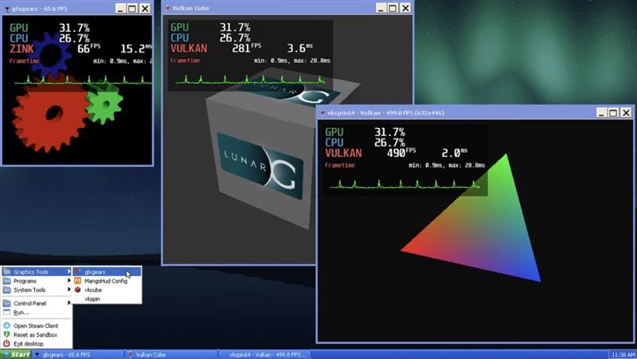 |

| VLC media player | SeaMonkey web browser |
| --- | --- |
| 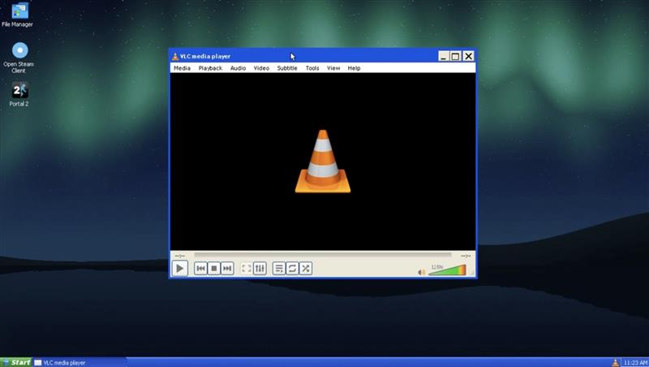 | 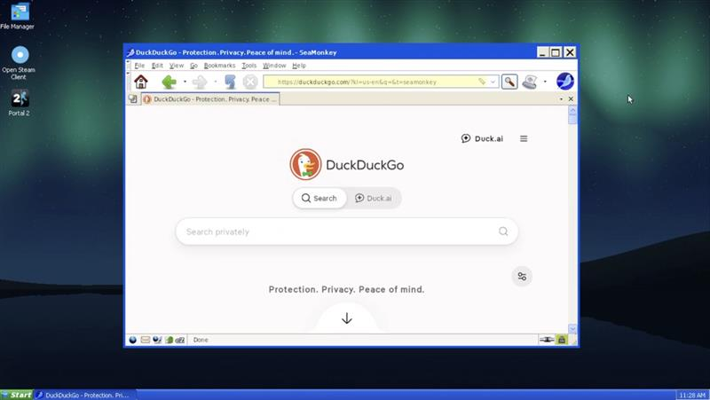 |

<a id="preparar-y-compilar"></a>


## Prepare and compile

In PowerShell, from the root:

```powershell
./tools/bootstrap.ps1 -InstallBuildTools
wsl -d Ubuntu-22.04
```

In WSL, enter this directory and run:

```bash
python3 tools/fetch_sources.py
python3 tools/build.py
```

`fetch_sources.py` uses only `sources.lock.json`; refuse to overwrite checkouts from another review. The source of Wine is fixed to the same commit as upstream. Unload it does not imply that your port PS4 has been built.

`build.py` verifies the sources, compiles for `x86_64-pc-freebsd12-elf` and Jaguar, generates the OLF and `eboot.bin`, and builds the EXE i386 `console32.exe` and `gdi32.exe`. It also checks its architectures and rejects PT_LOAD duplicate segments. The `out/build.json` manifesto records tools, sources and hashes.

For this milestone of C it is used OpenOrbis official v0. 5.4 and Clang 14 of Ubuntu 22.04. The sysroot C + + / Clang 21 of DolphinPS4 and Mesa are reserved for the graphic milestone; They have not yet been built or validated. `--sdk`, `--cc` and `--ld` allow to indicate another SDK/compilador to the builder, which is recorded in the manifesto.

<a id="ejecutar-los-diagnósticos"></a>


## Run the diagnostics

Development and regression testing in Linux/WSL uses a **patched shadPS4 fork**.
Results from the official emulator are recorded separately; fork success does not
establish compatibility with the official release or physical PS4 hardware.

The emulator source is reconstructed from the upstream revision and 17 ordered
patches pinned in [fork.lock.json](fork.lock.json). The patches are in
[patches/shadPS4/](patches/shadPS4/), followed by the
[0018 overlay](patches/shadPS4/pending/0018-fixed-executable-and-kernel-signals.patch)
recorded in [dependencies.lock.json](dependencies.lock.json). The generated source
checkout lives in `.deps/shadPS4-fork/` and is excluded from Git.

With the OpenOrbis SDK from the preparation step available, restore and build the
fork in Ubuntu 22.04/WSL:

```bash
bash tools/ci/install-runner.sh
python3 tools/restore-dependencies.py --fetch --only shadps4-fork
python3 tools/build-shad-linux.py --jobs 4
```

`install-runner.sh` installs the pinned Linux build prerequisites, including
Clang 19, libc++ and CMake. The resulting emulator is
`build/shadPS4-linux/shadps4`; its source identity, diff and binary hash are recorded
in `build/shadPS4-linux/build-manifest.json`. Use
`python3 tools/run-linux-shad.py --fork ...` to select that binary explicitly.
See the [emulator build and run guide](AGENTS.md#6-building-and-running-shadps4)
and [patch reconstruction details](docs/REPOSITORY_LAYOUT.md) for complete commands.

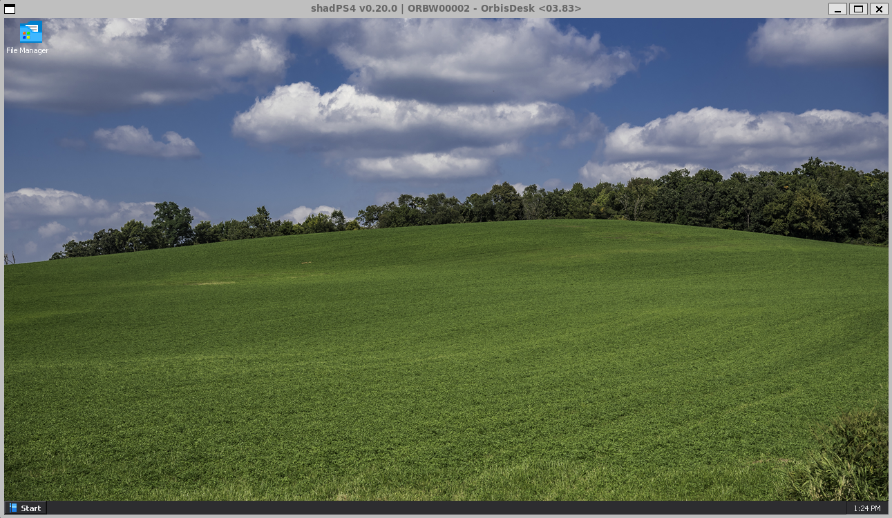

*OrbisDesk W284 / 03.83 desktop in the patched shadPS4 fork.*

The historical Windows reference runner is also available, in PowerShell:

```powershell
./tools/run-probes.ps1
./tools/run-probes.ps1 -Cases translator-rwx,vm-backend,threads-adapter
./tests/report-classification.ps1
```

Each case starts a new process with an isolated profile and `/data`. The reports are left in `reports/runs/<fecha UTC>/report.json`, along with stdout, stderr and the emulator's log. A matrix with blocked tests returns 1 code.

For a modified emulator in that Windows runner, use `-Emulator <path> -EmulatorKind fork -EmulatorCommit <full SHA>`. The official binary is identified by hash; a fork is never labeled as official. The older Windows fork scripts, `tools/prepare-shad-fork.ps1` and `tools/build-shad.ps1`, are historical entry points; the current Linux reconstruction and build are shown above.

The runner requires a start and a guest result, detects calls to stubs and treats timeouts/crashes as blockages. A simulated response of shadPS4 does not turn a test into approved. The warnings about unused imports are kept in the logs and are distinguished from stubs actually invoked.

<a id="organización"></a>


## Organization

- `platform/ps4/`: new adapters that consume the original interface of prospero-win.
- `native/`: diagnosis OpenOrbis, with one case per execution.
- `fixtures/win32/`: own programs PE32 for future milestones Wine/GDI.
- `tools/`: fixed sources, verified downloads, build and capture evidence.
- `upstream/`, `.deps/`, `build/`, `out/`: regenerable local sources and artifacts.

The EXs themselves are objectives of future acceptance, we do not have declared them functional in the runtime. The single-test software, thread, loading DLL and file writing; The GDI color changes when you receive input.

## License

The OrbisDesk package (`OrbisDesk.pkg` and its ELF) is distributed under the **GNU General Public License v3.0 or later**. It includes the native Steam client, which reuses code from [Playden for PS5](https://github.com/leolobato/playden-ps5) (GPL-3.0-or-later). The combined work is therefore GPL-3.0-or-later.

Individual source files keep the license stated in their headers:
- own adapters, tools and fixtures: LGPL-2.1-or-later;
- `native/` diagnostics: GPL-2.0-or-later;
- Wine: LGPL-2.1-or-later.

All of these are compatible with GPL-3.0-or-later. Optional per-game Steam API emulation uses unmodified [gbe_fork](https://github.com/Detanup01/gbe_fork) DLLs (LGPL-3.0).

License texts are in [LICENSES/](LICENSES). Components, versions and provenance are detailed in [THIRD_PARTY.md](THIRD_PARTY.md).

The Steam client is not official and is not endorsed by Valve. Steam is a trademark of Valve Corporation.
